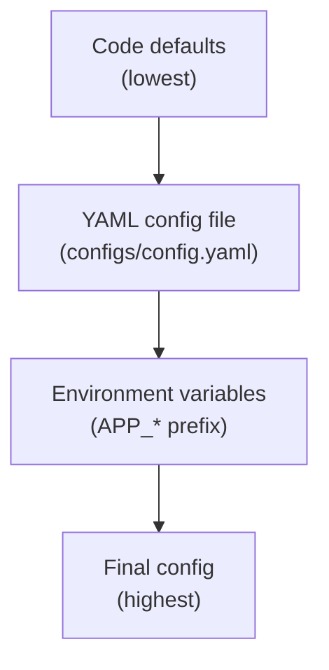

# Configuration

{{ cookiecutter.project_name }} uses [Koanf](https://github.com/knadh/koanf) for type-safe configuration management. Configuration is loaded from multiple sources with a clear precedence order.

## Configuration Sources

| Source | Priority | Description |
|--------|----------|-------------|
| Environment variables | Highest | `APP_*` prefixed variables override everything |
| YAML config file | Medium | `configs/config.yaml` provides defaults |
| Code defaults | Lowest | Hardcoded fallbacks in `config.Load()` |

### Precedence Order



Environment variables always win. If `APP_SERVER_PORT=9000` is set, it overrides any value in `configs/config.yaml` or the code default.

## YAML Config File

The default config file is `configs/config.yaml`:

```yaml
server:
  port: 8080
  environment: "development"
  read_timeout: 30
  write_timeout: 30
  rate_limit: 100

database:
  driver: "sqlite"
  dsn: "app.db"
  max_open_conns: 25
  max_idle_conns: 5
  conn_max_lifetime: 3600

redis:
  addr: "localhost:6379"
  db: 0

log:
  level: "debug"
  format: "json"

auth:
  auth_method: api_key
  jwt_secret: ""
  api_key: ""

cors:
  allowed_origins: []
  allowed_methods: ["GET", "POST", "PUT", "DELETE", "OPTIONS"]
  allowed_headers: ["Content-Type", "Authorization"]
```

The file is optional. If it doesn't exist, `config.Load()` uses environment variables and code defaults.

## Environment Variables

Environment variables use the `APP_` prefix. Use `__` (double underscore) for nested keys to preserve field names with underscores:

| Variable | Config Key | Description |
|----------|------------|-------------|

| `APP_SERVER_PORT` | `server.port` | Server port |
| `APP_SERVER_ENVIRONMENT` | `server.environment` | Environment name |

| `APP_DATABASE_DRIVER` | `database.driver` | Database driver (`sqlite` or `postgres`) |
| `APP_DATABASE_DSN` | `database.dsn` | Database connection string |
| `APP_DATABASE__MAX_OPEN_CONNS` | `database.max_open_conns` | Max open connections |

| `APP_REDIS_ADDR` | `redis.addr` | Redis address |

| `APP_LOG_LEVEL` | `log.level` | Log level (`debug`, `info`, `warn`, `error`) |
| `APP_LOG_FORMAT` | `log.format` | Log format (`json` or `text`) |

| `APP_AUTH_JWT_SECRET` | `auth.jwt_secret` | JWT secret |


**Nesting convention:** `APP_SECTION__FIELD` maps to `section.field`. The `__` delimiter preserves underscores in field names (e.g., `max_open_conns`). Without it, `APP_DATABASELOG_MAX_OPEN_CONNS` would become `database.max.open.connslog.max.open.conns.

## Config Structure

The config is defined as Go structs in `internal/config/config.go`:

```go
type Config struct {
    Server   ServerConfig   `koanf:"server"`
    Database DatabaseConfig `koanf:"database"`
    Redis    RedisConfig    `koanf:"redis"`
    Log      LogConfig      `koanf:"log"`
    Auth     AuthConfig     `koanf:"auth"`
    Cors     CorsConfig     `koanf:"cors"`

}

type ServerConfig struct {
    Port         int    `koanf:"port"`
    Environment  string `koanf:"environment"`
    ReadTimeout  int    `koanf:"read_timeout"`
    WriteTimeout int    `koanf:"write_timeout"`
    RateLimit    int    `koanf:"rate_limit"`
}

type DatabaseConfig struct {
    Driver          string `koanf:"driver"`
    DSN             string `koanf:"dsn"`
    MaxOpenConns    int    `koanf:"max_open_conns"`
    MaxIdleConns    int    `koanf:"max_idle_conns"`
    ConnMaxLifetime int    `koanf:"conn_max_lifetime"`
}

type RedisConfig struct {
    Addr     string `koanf:"addr"`
    Password string `koanf:"password"`
    DB       int    `koanf:"db"`
}

type LogConfig struct {
    Level  string `koanf:"level"`
    Format string `koanf:"format"`
}

type AuthConfig struct {
    JwtSecret string `koanf:"jwt_secret"`
}

type CorsConfig struct {
    AllowedOrigins []string `koanf:"allowed_origins"`
    AllowedMethods []string `koanf:"allowed_methods"`
    AllowedHeaders []string `koanf:"allowed_headers"`
}
```

The `koanf` tags map struct fields to config keys. Koanf uses these tags when unmarshaling.

## Adding New Config Fields

1. **Add the field to the appropriate config struct:**

    ```go
    type ServerConfig struct {
        Port        string `koanf:"port"`
        Environment string `koanf:"environment"`
        ReadTimeout int    `koanf:"read_timeout"`  // New field
    }
    type LogConfig struct {
        Level  string `koanf:"level"`
        Format string `koanf:"format"`
        NewField string `koanf:"new_field"`  // New field
    }
    ```

2. **Add a default value in `config.Load()`:**

    ```go
    if cfg.Server.ReadTimeout == 0 {
        cfg.Server.ReadTimeout = 30
    }
    if cfg.Log.NewField == "" {
        cfg.Log.NewField = "default"
    }
    ```

3. **Add the environment variable to `.env.example`:**

    ```bash
    APP_SERVER_READ_TIMEOUT=30
    APP_LOG__NEW_FIELD=default
    ```

4. **Add the field to `configs/config.yaml` if it should be configurable by file:**

    ```yaml
    server:
      read_timeout: 30
    log:
      new_field: default
    ```

## Defaults

Code defaults are the fallback when neither the config file nor environment variables provide a value:

| Field | Default |
|-------|---------|

| `server.port` | `8080` |
| `server.environment` | `"development"` |
| `server.read_timeout` | `30` |
| `server.write_timeout` | `30` |
| `server.rate_limit` | `100` |

| `database.driver` | `"sqlite"` |
| `database.dsn` | `"app.db"` |
| `database.max_open_conns` | `25` |
| `database.max_idle_conns` | `5` |
| `database.conn_max_lifetime` | `3600` |

| `redis.addr` | `"localhost:6379"` |

| `log.level` | `"info"` |
| `log.format` | `"json"` |

| `auth.auth_method` | `"api_key"` |
| `auth.jwt_secret` | `""` |
| `auth.api_key` | `""` |


These defaults are applied in `applyDefaults()` after loading the file and environment variables.

## Secret Handling

Sensitive values should be handled via environment variables — never stored in `configs/config.yaml` or `.env.example`.

### Local Development

Use `.env` (not committed to git) for local secrets:

```bash
# .env (gitignored)
APP_DATABASE_DSN=host=localhost user=postgres password=MY_SECRET_PASSWORD dbname=app port=5432 sslmode=disable

APP_AUTH_JWT_SECRET=change-me

```

The justfile loads `.env` automatically via `set dotenv := true`.

### Production

Inject secrets via your deployment platform:

| Platform | Method |
|----------|--------|
| Kubernetes | Secrets mounted as environment variables |

| Docker | `-e` flags or Docker secrets |

| Heroku | Config vars |
| AWS ECS | Secrets Manager + task definition |
| Fly.io | Platform secrets |

### .env.example

The `.env.example` file provides the shape of required environment variables with placeholder values:

```bash
# Database
APP_DATABASE_DRIVER=postgres
APP_DATABASE_DSN=host=localhost user=postgres password=CHANGE_ME dbname=app port=5432 sslmode=disable

# Auth
APP_AUTH_JWT_SECRET=

```

Never commit real secrets. Copy `.env.example` to `.env` and fill in real values.

## Development vs. Production Config

The template is designed for the same code to run in both environments with different configuration:

| Setting | Development | Production |
|---------|-------------|------------|

| `server.environment` | `development` | `production` |

| `database.driver` | `sqlite` | `postgres` |
| `database.dsn` | `app.db` | PostgreSQL connection string |

| `log.level` | `debug` | `info` |
| `log.format` | `json` | `json` |

| `auth.auth_method` | `api_key` | `api_key` |
| `auth.jwt_secret` | empty | strong secret |
| `auth.api_key` | empty | strong key |


Switch environments by changing environment variables or the config file. No code changes needed.

### Environment Detection

Use `cfg.Server.Environment` to adjust behavior:

```go
if cfg.Server.Environment == "development" {
    // Enable debug features, verbose logging
    handler = slog.NewTextHandler(os.Stdout, &slog.HandlerOptions{
        Level:   slog.LevelDebug,
        AddSource: true,
    })
} else {
    // Production defaults
    handler = slog.NewJSONHandler(os.Stdout, &slog.HandlerOptions{
        Level: slog.LevelInfo,
    })
}
```
Use environment variables or config file settings to adjust behavior between development and production.

## Loading Configuration

Configuration is loaded once at startup via `config.Load()`:

```go
func Load() (*Config, error) {
    k := koanf.New(".")

    // 1. Load YAML config file (optional)
    if _, err := os.Stat("configs/config.yaml"); err == nil {
        if err := k.Load(file.Provider("configs/config.yaml"), yaml.Parser()); err != nil {
            return nil, fmt.Errorf("failed to load config file: %w", err)
        }
    }

    // 2. Load .env file into os.Env (optional)
    _ = godotenv.Load()

    // 3. Load environment variables with APP_ prefix
    // Uses __ for nesting: APP_DATABASE__MAX_OPEN_CONNS → database.max_open.connsLOG__LEVEL → log.level
    if err := k.Load(env.Provider("APP_", ".", func(s string) string {
        key := strings.TrimPrefix(s, "APP_")
        if idx := strings.Index(key, "__"); idx != -1 {
            section := strings.ToLower(strings.ReplaceAll(key[:idx], "_", "."))
            field := strings.ToLower(key[idx+2:])
            return section + "." + field
        }
        return strings.ToLower(strings.ReplaceAll(key, "_", "."))
    }), nil); err != nil {
        return nil, fmt.Errorf("failed to load env vars: %w", err)
    }

    // 4. Apply defaults for missing values
    applyDefaults(k)

    // 5. Unmarshal to struct
    cfg := &Config{}
    if err := k.Unmarshal("", cfg); err != nil {
        return nil, fmt.Errorf("failed to unmarshal config: %w", err)
    }

    return cfg, nil
}
```

For production readiness, call `cfg.ValidateForProduction()` after `Load()`. It requires explicit DSN. It requires JWT secret and non-default port.
