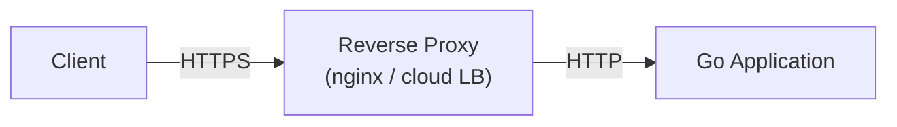

# Security

This document covers security considerations for {{ cookiecutter.project_name }}.

## Input Validation

All API input is validated through Huma's request schemas. The framework automatically:

- Validates required fields
- Enforces type constraints
- Limits string lengths
- Validates enum values

```go
type CreateItemInput struct {
    Name        string  `query:"name" doc:"Item name" maxlength:"255"`
    Description *string `query:"description" doc:"Item description" maxlength:"10000"`
}
```

Never trust client input — always define explicit schemas.
## Secrets Management

JWT-based authentication is available in `internal/middleware/auth.go`. Enable it by setting the `APP_AUTH_JWT_SECRET` environment variable.

```bash
# Enable authentication
APP_AUTH_JWT_SECRET="your-secret-key-here"

# Disable authentication (default — all endpoints public)
# APP_AUTH_JWT_SECRET=""
```
### Secret Storage

In Docker Compose, use environment files or Docker secrets:

```yaml
secrets:
  jwt_secret:
    file: ./secrets/jwt_secret.txt

services:
  app:
    secrets:
      - jwt_secret
    environment:
      - APP_AUTH_JWT_SECRET=/run/secrets/jwt_secret
```
Never commit secrets to version control. The `.env.example` file shows the shape of secrets without actual values.

### Rotation

Rotate the JWT secret periodically. Existing tokens become invalid after rotation — plan for this in your deployment strategy.
## CORS

Cross-Origin Resource Sharing is configurable via `APP_CORS_ALLOWED_ORIGINS`.

```bash
# Restrict to specific origins
APP_CORS_ALLOWED_ORIGINS="https://app.example.com,https://admin.example.com"

# Allow all origins (default — fine for development, restrict in production)
# APP_CORS_ALLOWED_ORIGINS="*"
```
## Dependencies

Keep dependencies updated. Run vulnerability checks regularly:

```bash
just vuln-check
```

This uses [govulncheck](https://go.dev/browse/vuln/) to check against the Go vulnerability database.
## Container Security

The Dockerfile uses a distroless runtime image:

- No shell access in the production container
- Minimal attack surface
- Non-root user

The builder stage includes the Go toolchain. The runtime stage only includes the compiled binary.
## HTTPS

Terminate TLS at your reverse proxy or load balancer, not in the Go application.



The application listens on HTTP. Your reverse proxy handles TLS termination, certificate management, and HTTP/2.
## Checklist

- [ ] Secrets stored in environment variables or secret managers, not code
- [ ] JWT secret is strong (256+ bits of entropy)
- [ ] CORS origins restricted to known domains
- [ ] Input validated through Huma schemas
- [ ] Dependencies updated and vulnerability-checked
- [ ] Container runs as non-root user
- [ ] Distroless runtime image used in production
- [ ] TLS terminated at reverse proxy
- [ ] `.env` file is in `.gitignore`