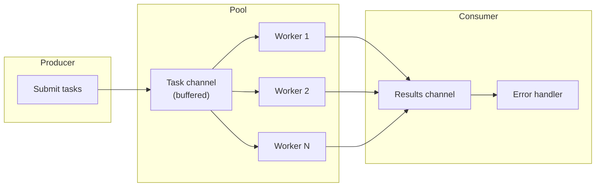
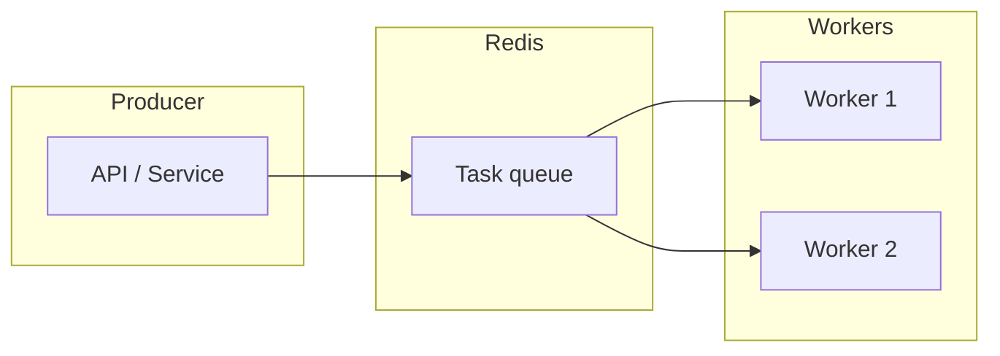

# Background Workers

{{ cookiecutter.project_name }} supports two types of background processing:

1. **Worker pools** for CPU-bound tasks — pure Go, no external dependencies
2. **Asynq** for distributed I/O-bound tasks — Redis-backed, with retry and scheduling

## Worker Pools (CPU-Bound)

Worker pools use Go channels and goroutines. They're ideal for CPU-intensive tasks that don't need persistence or distributed execution.

### Architecture



### Usage

```go
pool := worker.NewPool(ctx, 4, logger)
pool.Start()

// Submit tasks
pool.Submit(func(ctx context.Context) error {
    // CPU-bound work
    return nil
})

// Graceful shutdown
pool.Stop()
```

The pool size determines how many tasks run concurrently. Tune it based on your CPU cores and task characteristics.

### When to Use Worker Pools

- Data transformation (image processing, encoding, compression)
- Batch computations (statistics, aggregations)
- In-memory operations with no external I/O
- Tasks that complete within seconds

### Limitations

- **No persistence:** If the process crashes, in-flight tasks are lost
- **No retry:** Failed tasks don't automatically retry
- **Single process:** Tasks run only on the process that submitted them

## Asynq (Distributed I/O-Bound)

[Asynq](https://github.com/hibiken/asynq) is a Redis-backed distributed task queue. It provides persistence, retry, scheduling, and result tracking.

### Architecture



### Adding a New Task Type

1. **Define the task type constant and payload:**

   ```go
   const TaskTypeSendEmail = "email:send"

   type SendEmailPayload struct {
       To      string `json:"to"`
       Subject string `json:"subject"`
       Body    string `json:"body"`
   }
   ```

2. **Create the task:**

   ```go
   func NewSendEmailTask(to, subject, body string) *asynq.Task {
       payload, _ := json.Marshal(SendEmailPayload{
           To: to, Subject: subject, Body: body,
       })
       return asynq.NewTask(TaskTypeSendEmail, payload,
           asynq.MaxRetry(3),
           asynq.Queue("default"),
       )
   }
   ```

3. **Create the handler:**

   ```go
   func SendEmailHandler(logger *slog.Logger) asynq.Handler {
       return &sendEmailHandler{logger: logger}
   }

   type sendEmailHandler struct {
       logger *slog.Logger
   }

   func (h *sendEmailHandler) ProcessTask(ctx context.Context, t *asynq.Task) error {
       var payload SendEmailPayload
       if err := json.Unmarshal(t.Payload(), &payload); err != nil {
           return err
       }
       // Send email logic
       h.logger.Info("email sent", slog.String("to", payload.To))
       return nil
   }
   ```

4. **Register the handler:**

   ```go
   srv := asynq.NewServer(redis.Opt{}, asynq.Config{
       Concurrency: 10,
   })

   mux := asynq.NewServeMux()
   mux.HandleFunc(TaskTypeSendEmail, SendEmailHandler(logger))

   if err := srv.Run(mux); err != nil {
       log.Fatalf("failed to run server: %v", err)
   }
   ```

5. **Enqueue the task from a handler or service:**

   ```go
   task := worker.NewSendEmailTask("user@example.com", "Welcome", "Hello!")
   if err := client.Enqueue(task); err != nil {
       return fmt.Errorf("enqueue task: %w", err)
   }
   ```

### Task Options

| Option | Description | Default |
|--------|-------------|---------|
| `asynq.MaxRetry(n)` | Maximum retry attempts | 25 |
| `asynq.Queue(name)` | Queue name for priority | `"default"` |
| `asynq.ProcessIn(d)` | Delay before processing | Immediate |
| `asynq.Schedule(t)` | Run at specific time | N/A |
| `asynq.RemoveDuplicated()` | Skip if identical task exists | false |

### Queues and Priority

Asynq supports multiple queues with different priorities:

| Queue | Priority | Use Case |
|-------|----------|----------|
| `critical` | Highest | Time-sensitive tasks (notifications, alerts) |
| `default` | Medium | Standard background tasks |
| `low` | Lowest | Non-urgent tasks (analytics, reporting) |

Configure queue priorities in the server:

```go
srv := asynq.NewServer(redis.Opt{}, asynq.Config{
    Queues: map[string]int{
        "critical": 6,
        "default":  5,
        "low":      3,
    },
    Concurrency: 10,
})
```

### Running Workers Locally

Start the Asynq worker alongside the main application:

```go
// In main.go, after setting up the API server
go func() {
    redisOpt := redis.Opt{
        Addr:     "localhost:6379",
        Password: "",
    }
    srv := asynq.NewServer(redisOpt, asynq.Config{
        Concurrency: 5,
    })
    mux := asynq.NewServeMux()
    mux.HandleFunc(worker.TaskTypeProcessData, worker.ProcessDataHandler(logger))
    if err := srv.Run(mux); err != nil {
        logger.Error("asynq server failed", slog.String("error", err.Error()))
    }
}()
```

Redis must be running locally. Use Docker Compose: `just docker-up`.

### Monitoring

Asynq provides a web-based inspector for monitoring tasks:

```go
inspector := asynqmon.New(asynqmon.Options{
    Addr:         ":8084",
    Redis:        redis.Opt{Addr: "localhost:6379"},
    ReadTimeout:  10 * time.Second,
    WriteTimeout: 10 * time.Second,
    AuthFunc: func(username, password string) error {
        if username == "admin" && password == "password" {
            return nil
        }
        return errors.New("invalid credentials")
    },
})
inspector.Run()
```

Visit `http://localhost:8084` to view:

- Pending, active, and completed tasks
- Failed tasks and retry counts
- Queue depths and processing rates

### Retry Behavior

Asynq automatically retries failed tasks with exponential backoff:

| Attempt | Delay |
|---------|-------|
| 1 | 10 seconds |
| 2 | 30 seconds |
| 3 | 1 minute |
| 4 | 4 minutes |
| 5+ | 8 minutes |

After exhausting retries, the task moves to the discard queue. Handle discarded tasks in your monitoring or set up a dead letter queue.

Return specific error types to control retry behavior:

```go
// Permanent error — don't retry
return asynq.SkipRetry

// Retry after specific delay
return asynq.ErrorWrap(fmt.Errorf("rate limited"), asynq.RetriesRemaining(5), asynq.ProcessIn(5*time.Minute))
```

## Choosing Between Worker Pools and Asynq

| Factor | Worker Pool | Asynq |
|--------|-------------|-------|
| Dependency | None | Redis |
| Persistence | No | Yes |
| Retry | Manual | Automatic |
| Distribution | Single process | Multiple workers |
| Scheduling | Manual | Built-in |
| Monitoring | Custom | Inspector UI |
| Complexity | Low | Medium |
| Use Case | CPU-bound, in-process | I/O-bound, distributed |

**Rule of thumb:** Use worker pools for simple, CPU-bound tasks. Use Asynq for I/O-bound tasks that need persistence, retry, or distributed execution.
